# Hyson Detector — Architecture

Every layer of the solution, from the data in **Microsoft Fabric** to the models (**ML**), the language model in
**Azure AI Foundry** (**DL**) and each **AI pipeline** of the app. All diagrams are Mermaid (rendered by GitHub);
PNG versions for slides are in [`img/`](img/).

Principle everywhere: **the model scores, the AI explains, the analyst decides.**

| # | View | What it answers |
|---|---|---|
| 1 | [End-to-end architecture](#1-end-to-end-architecture) | How the pieces fit: Fabric → models → Foundry → app → analyst → feedback |
| 2 | [Microsoft Fabric data platform](#2-microsoft-fabric-data-platform) | Lakehouse layers, every table, notebooks, pipeline, SQL endpoint, Power BI, MLflow |
| 3 | [ML pipeline: features, training, scoring, explanations](#3-ml-pipeline-features-training-scoring-explanations) | Notebooks 01 and 02 step by step |
| 4 | [Validation and MLOps lifecycle](#4-validation-and-mlops-lifecycle) | Notebook 04, MLflow registry, retraining pipeline, monitoring, feedback |
| 5 | [Azure AI Foundry and Azure OpenAI layer](#5-azure-ai-foundry-and-azure-openai-layer) | Project, deployment, safety filter, settings, every caller |
| 6 | [Where ML and DL are used](#6-where-ml-and-dl-are-used) | Rules vs machine learning vs deep learning, and the DL roadmap |
| 7 | [AI pipelines, one by one](#7-ai-pipelines-one-by-one) | Copilot, Le Procès, Enquête approfondie, Reconstitution, person search, data onboarding, copilot evaluation, Power BI as code |
| 8 | [Application pages and demo path](#8-application-pages-and-demo-path) | The 15 pages and how they link |
| 9 | [Deployment, security and CI/CD](#9-deployment-security-and-cicd) | Local live mode vs hosted demo, identities, secrets, GitHub → Streamlit Cloud |

---

## 1. End-to-end architecture

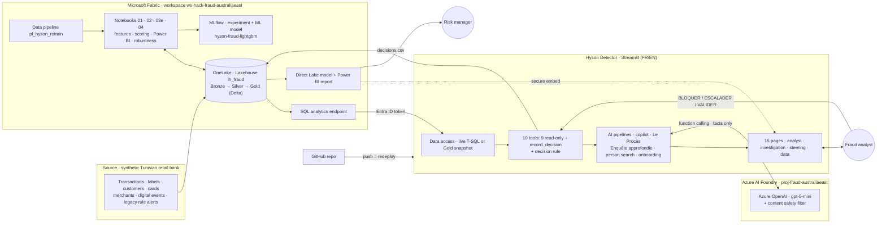

| Layer | Technology | Role |
|---|---|---|
| Data platform | Microsoft Fabric: OneLake, Lakehouse `lh_fraud`, Delta tables, Spark notebooks, data pipeline | Ingest, clean, compute features, score, store everything the app reads |
| Machine learning | LightGBM (champion) + HGB / LambdaRank / blend (challengers), TreeSHAP, MLflow | Fraud score, explanations, model registry |
| Deep learning | gpt-5-mini (transformer LLM) deployed in Azure AI Foundry | Understands the analyst's question, writes the explanation from tool facts |
| Application | Streamlit (Python), 10 tools, 8 AI pipelines | Analyst workflow: queue → transaction → explanation → decision |
| BI | Direct Lake semantic model + Power BI report (built as code) | Manager KPIs, embedded in the app |
| Delivery | GitHub, Streamlit Community Cloud | Versioning, hosted demo, auto-redeploy on push |

---

## 2. Microsoft Fabric data platform

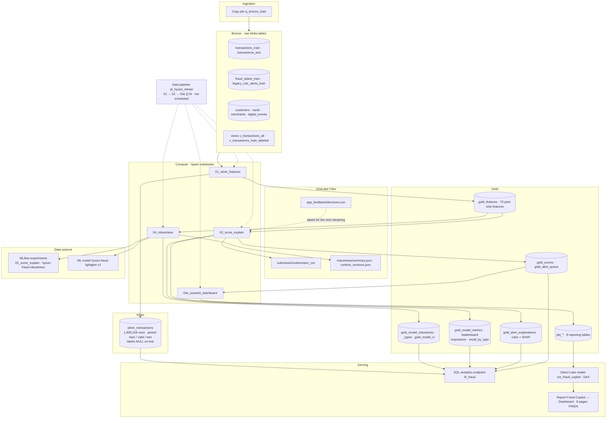

| Item | Content | Written by | Read by |
|---|---|---|---|
| Bronze | CSVs as delivered (train Jan 2025 → Jul 2026, test Aug → Sep 2026) | Copy job | Notebook 01 |
| `silver_transactions` | Typed, joined (customer, card, merchant), `period` from the time split, labels nulled on test | 01 | 01, app (history, related cases), Power BI |
| `gold_features` | 73 features computed with past-only windows | 01 | 02, 04 |
| `gold_scores`, `gold_alert_queue` | Score, percentile, rank, top-1 % alert, risk level, demo cases | 02 | App, 03e, 04 |
| `gold_alert_explanations` | Top factors per alert: rules + TreeSHAP for and against | 02 | App, copilot tools |
| `gold_model_*` | Metrics, leaderboard, importance, recall by fraud type | 02 | App, 03e |
| `gold_model_robustness*`, `gold_model_ci` | Rolling backtest, bootstrap intervals | 04 | App (Performance page) |
| `pbi_*` | Reporting tables (FR + EN labels) | 03e | Direct Lake model |
| `Files/app_feedback/decisions.csv` | Analyst decisions with time-to-decision | App | Next retraining |

---

## 3. ML pipeline: features, training, scoring, explanations

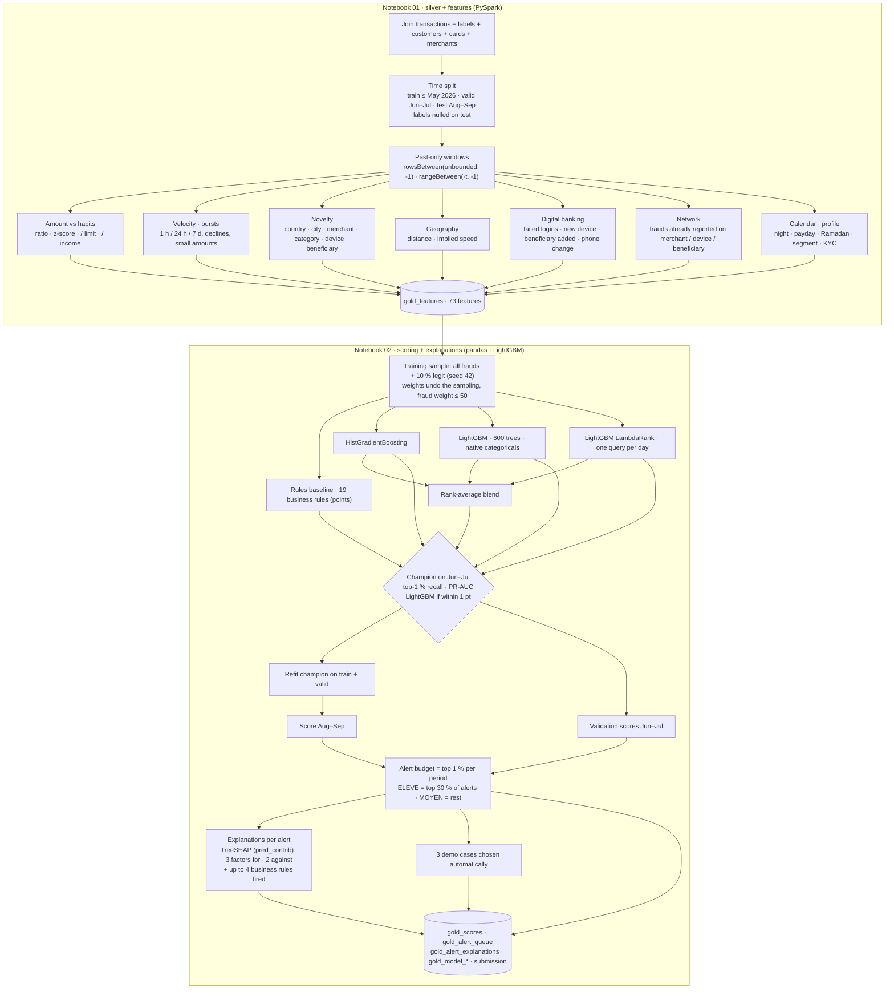

| Step | Method | Why |
|---|---|---|
| Split | By time, never random (train ≤ May 2026, valid Jun–Jul, test Aug–Sep) | A random split mixes the same fraud episode between train and validation |
| Features | Spark window functions over the **past only**; graph features count only frauds reported **before** the transaction | No future information (brief §7, §8.6) |
| Excluded | `gender`, IDs, `fraud_scenario`, `fraud_reported_date` (except "already reported"), target-encoded entity risk | Fairness and leakage (checked by an `assert`) |
| Imbalance | Down-sample legit to 10 %, sample weights restore the real ratio | 0.55 % fraud rate |
| Models | Rules · HGB · **LightGBM** · LambdaRank · blend | Gradient boosting is the reference for tabular data |
| Selection | Top-1 % recall then PR-AUC on Jun–Jul; LightGBM preferred within 1 pt | One model both scores and explains |
| Threshold | Top 1 % per period (analyst capacity) | Brief §8.4 |
| Explanations | TreeSHAP contributions from the same LightGBM + business rules | Facts the copilot reads instead of inventing |

---

## 4. Validation and MLOps lifecycle

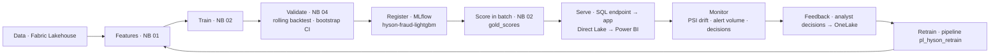

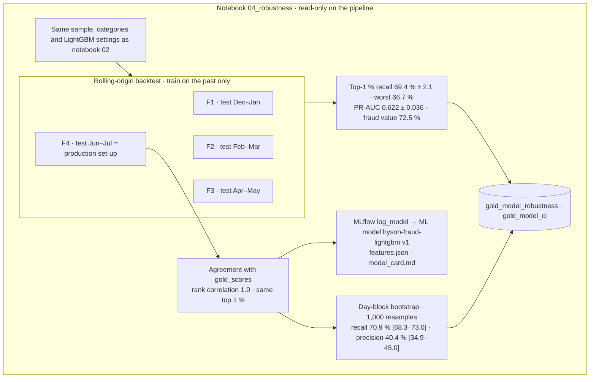

| MLOps element | Where | Status |
|---|---|---|
| Experiment tracking | MLflow experiments `02_score_explain`, `hyson-fraud-robustness` (1 run per fold) | ✅ |
| Model registry | ML model `hyson-fraud-lightgbm` v1 = production scores | ✅ |
| Orchestration | Data pipeline `pl_hyson_retrain` (01 → 02 → 03e ∥ 04, retry 1) | ✅ created, not scheduled (re-scoring changes demo IDs) |
| Reproducibility | Seeds, same sampling, `fabric/environment.yml` (runtime versions) | ✅ |
| Monitoring | PSI drift of the score distribution (Impact page), alert volume per day, copilot log | ✅ |
| Feedback loop | `decisions.csv` → OneLake `Files/app_feedback` → labels for the next run | ✅ |
| Next | Schedule the pipeline, champion/challenger in shadow mode, drift alert with Data Activator | Roadmap |

---

## 5. Azure AI Foundry and Azure OpenAI layer

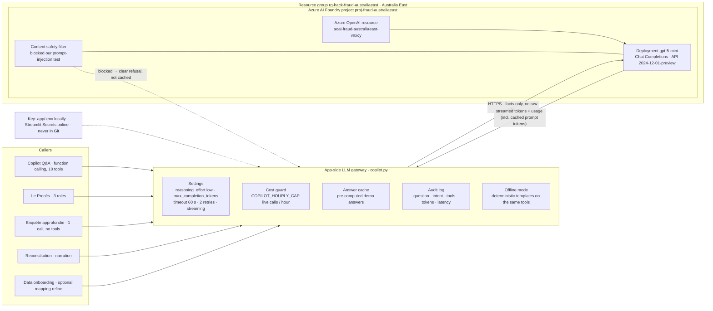

| Setting | Value | Why |
|---|---|---|
| Model | `gpt-5-mini` (reasoning model) | Good French/English, function calling, low cost |
| Reasoning effort | `low` (copilot, Le Procès) · `minimal` (Enquête approfondie, one retry with `low` if the answer contradicts itself) | Latency and tokens |
| Prompt | Static system prompt first (≈ 1,400–2,000 tokens served by Azure prompt caching), then facts | ≈ 3,300 tokens and ≈ 7 s per new question, 1 LLM round |
| Safety | Azure content filter + app guardrails (off-topic refusal, unknown ID answered without LLM, no field names, decision fixed by rule) | Brief §9.8 |
| Cost control | Cache, prefetch (1 round), hourly cap on the public demo, every call logged with tokens | FinOps |

---

## 6. Where ML and DL are used

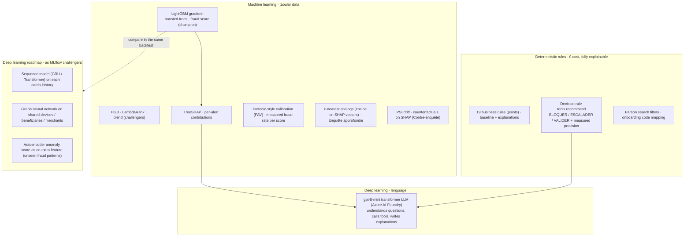

| Need | Technique | Type | Why this choice |
|---|---|---|---|
| Score each transaction | LightGBM | ML | Best on tabular data, fast, exact explanations (TreeSHAP), auditable by a risk team |
| Explain the score | TreeSHAP + business rules | ML + rules | Same model that scores, numbers the copilot can cite |
| Decide | Documented rule with measured precision | Rules | Reproducible; the LLM never decides |
| Talk with the analyst | gpt-5-mini | **DL** (transformer) | Natural language FR/EN, function calling, summarising |
| Similar past cases | Cosine k-NN on SHAP vectors | ML | 0 token, explains "alerts like this were X % fraud" |
| Why not DL for the score | — | — | Tabular data where boosting is the state of the art; DL adds cost and opacity. Kept as challengers (roadmap), validated with the same backtest and registered in MLflow before any switch |

---

## 7. AI pipelines, one by one

### 7.1 Copilot question → answer

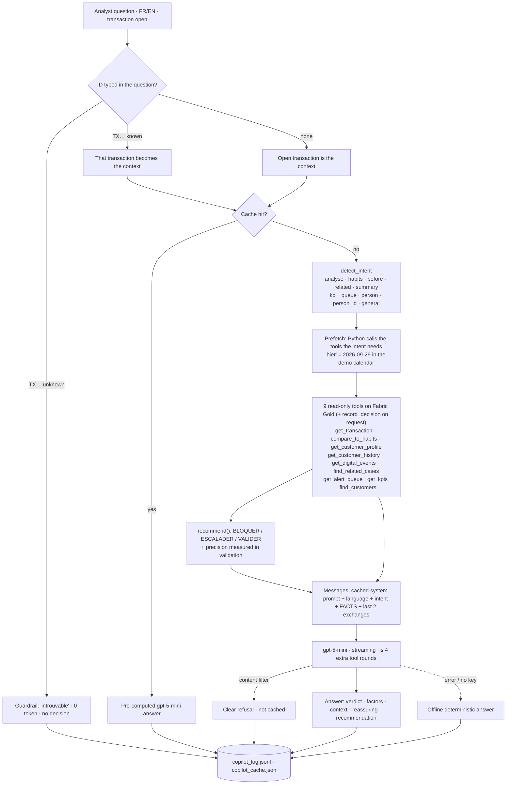

### 7.2 Le Procès (three AI roles)

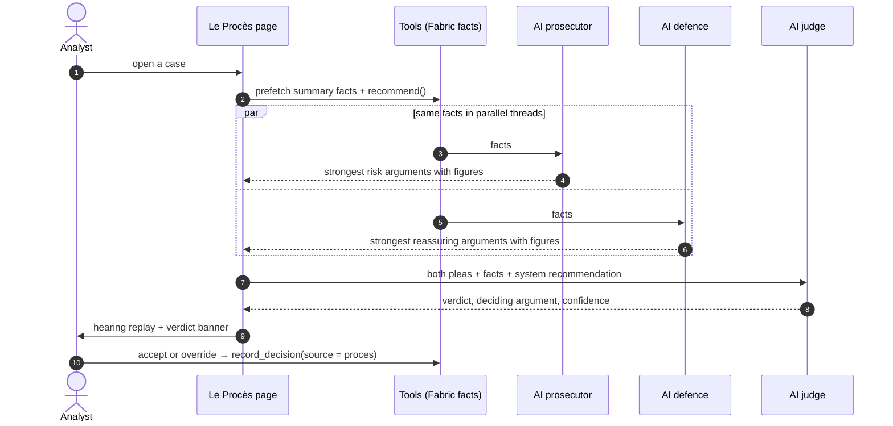

### 7.3 Enquête approfondie (deep search on medium alerts)

```mermaid
flowchart LR
    W["watch() · 0 token<br/>MEDIUM alerts whose customer had an alert in the previous 72 h<br/>≈ 53 % fraud vs 16 % (validation)"] --> E
    subgraph E["evidence() · 0 token · numbered lines E1…En"]
        E1["Habits and amount gap"]
        E2["Digital events around the operation"]
        E3["Linked customers · points of compromise"]
        E4["Robustness: counterfactual on SHAP factors"]
        E5["25 most similar labelled alerts (cosine k-NN)"]
        E6["Previous analyst decisions"]
    end
    E --> LLM["investigate() · ONE gpt-5-mini call, no tools<br/>reasoning minimal · connects the dots"]
    LLM --> CHK{"Hypothesis and direction consistent?"}
    CHK -- no --> RT["One retry · reasoning low"]
    CHK -- yes --> OUT["Hypothesis · strengthen / lift · next check"]
    RT --> OUT
    OUT --> CL[("Cached per transaction + language · logged")]
```

### 7.4 Reconstitution (crime-scene replay)

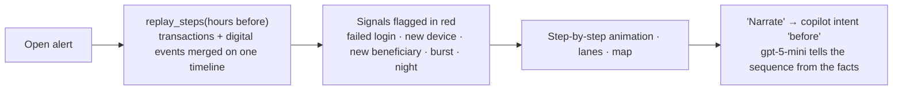

### 7.5 Person search ("le client retraité de Sfax de plus de 70 ans avec des alertes")

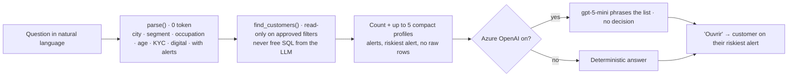

### 7.6 New data source onboarding (translate · measure · approve)

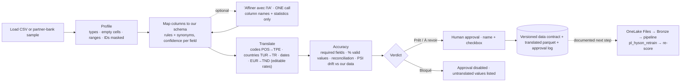

### 7.7 Copilot evaluation (golden questions)

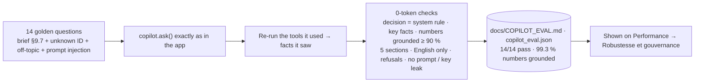

### 7.8 Power BI as code (notebook 03e)

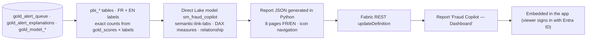

---

## 8. Application pages and demo path

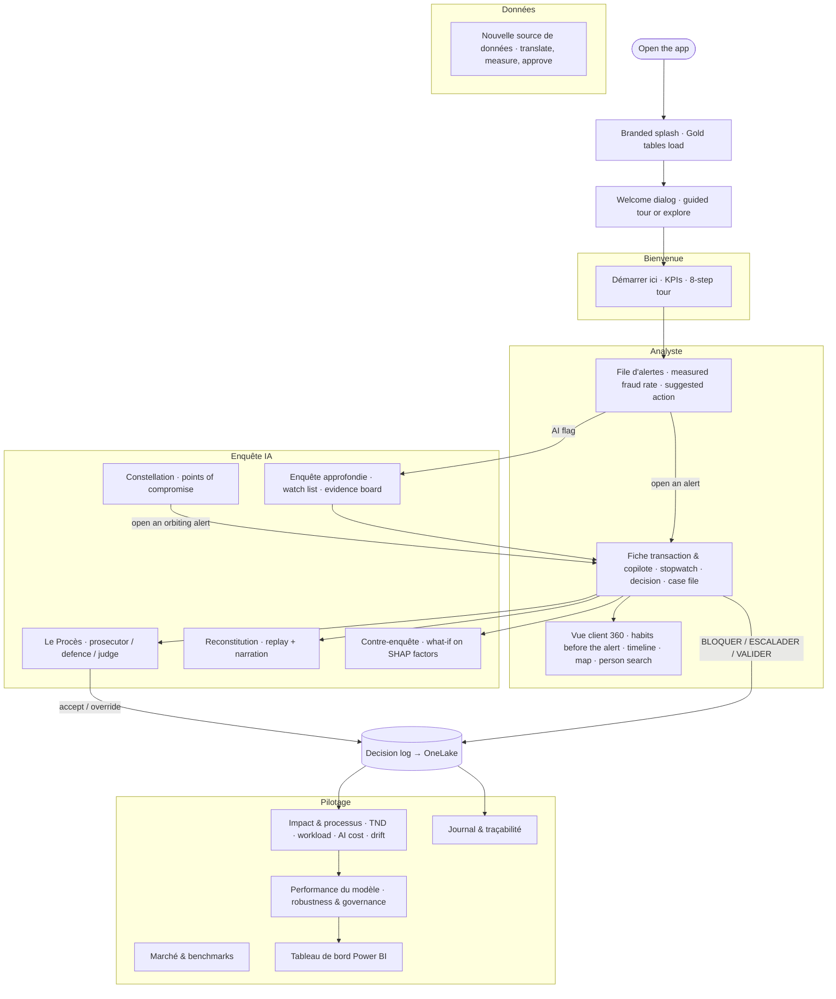

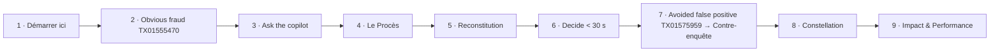

---

## 9. Deployment, security and CI/CD

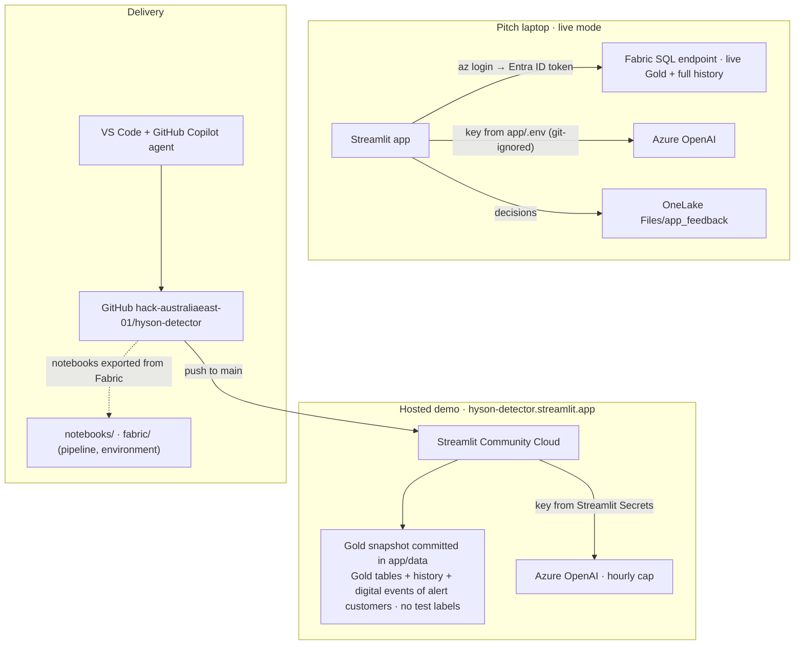

| Control | How |
|---|---|
| Identity | Fabric access with the analyst's Entra ID token (`az login`); no database password anywhere |
| Secrets | Azure OpenAI key only in `app/.env` (git-ignored) or Streamlit Secrets; scanned out of the repo and its history |
| Data minimisation | The LLM receives compact tool facts, never raw tables; person search uses approved filters; onboarding AI sees column names and statistics only |
| Labels | Test labels are NULL everywhere; graph features use frauds reported **before** the transaction |
| Traceability | Every LLM call logged (question, intent, tools, tokens, latency); every decision and data approval logged |
| Cost | Cache, 1-round prefetch, prompt caching, hourly cap on the public demo |
| Production next steps | Private endpoint + managed identity for Azure OpenAI, RBAC / row-level security, PII masking, real-time scoring with Eventstream + Eventhouse |
