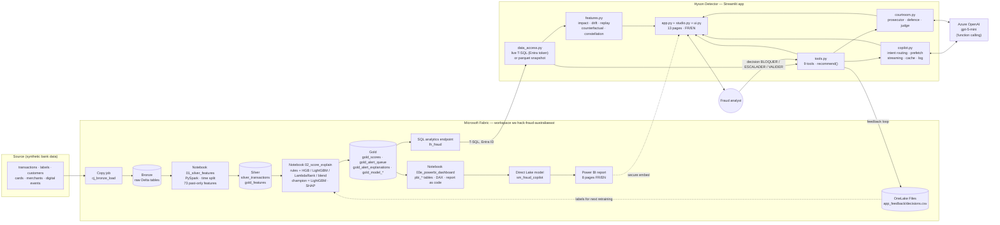
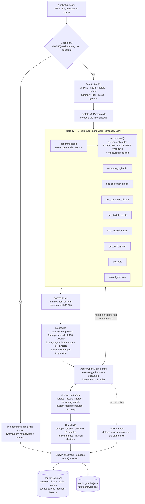
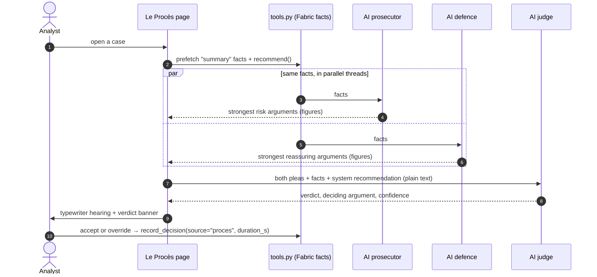
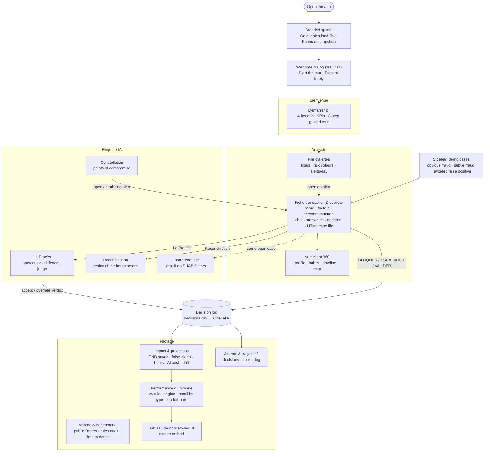
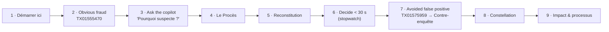

# Hyson Detector — Architecture

Three views, all rendered by GitHub (Mermaid):

1. [Global architecture](#1-global-architecture) — Microsoft Fabric → Gold → app / Power BI → Azure OpenAI → feedback
2. [AI workflow](#2-ai-workflow-copilot-and-le-procès) — how a question becomes a sourced answer (and how Le Procès works)
3. [Page workflow](#3-page-workflow-the-whole-app) — every page of the app and the demo path

Principle everywhere: **the model scores, the AI explains, the analyst decides.**

---

## 1. Global architecture

| Layer | Technology | Role |
|---|---|---|
| Ingestion | Fabric copy job → Lakehouse `lh_fraud` (Bronze) | Raw CSVs as Delta tables |
| Features | Notebook 01 (PySpark windows) | 73 features computed **only from the past** of each transaction; time split train ≤ May 2026 / valid Jun–Jul / test Aug–Sep |
| Scoring | Notebook 02 (LightGBM champion, SHAP) | Score, top-1 % alert queue (analyst capacity), rule + SHAP explanations, metrics vs the current rules engine |
| BI | Notebook 03e → Direct Lake → Power BI | Manager dashboard, built as code, FR/EN |
| Serving | SQL analytics endpoint | Live T-SQL from the app with the analyst's Entra token (no stored secret) |
| App | Streamlit | Alert queue, transaction view, AI investigation, steering pages |
| AI | Azure OpenAI gpt-5-mini | Explains with facts fetched by tools; never invents the score or the decision |
| Feedback | OneLake `Files/app_feedback/decisions.csv` | Analyst decisions (with time-to-decision) feed the next retraining |
| Hosted demo | Streamlit Community Cloud | Same code; reads the committed Gold snapshot (`app/data/*.parquet`) because the cloud has no Entra login |

---

## 2. AI workflow (copilot and Le Procès)

### 2.1 One question to the copilot

Measured: ~3,300 tokens (≈1,400 served from the Azure prompt cache), 1 LLM round, ~7 s per new question; cached demo answers are instant. The recommendation is computed by `tools.recommend` (percentile ≥ 0.998 and ≥ 2 signals → BLOQUER, 94 % precision in validation), so it is identical across questions and languages.

### 2.2 Le Procès (three AI roles)

### 2.3 Other AI and analytics features

| Feature | How it works | AI used |
|---|---|---|
| Reconstitution | `features.replay_steps`: transactions + digital events in the hours before the alert, risky signals flagged | gpt-5-mini narrates (copilot intent `before`) |
| Contre-enquête | `features.counterfactual`: neutralise the top SHAP factors (log-odds) one by one → robust / sensitive | none (pure model maths) |
| Constellation | `features.constellation`: points of compromise (lift ×2.5–×4.1) + today's alerts orbiting them (networkx) | none; shown as an investigation lead (not predictive in validation) |
| Impact & processus | `features.impact`, `features.drift` (PSI) | AI cost per alert from the copilot log |

---

## 3. Page workflow (the whole app)

### Demo path (≈ 3 minutes)

---

## 4. Where it runs

| | Local (pitch laptop) | Hosted (Streamlit Community Cloud) |
|---|---|---|
| Data | **Live** Fabric SQL endpoint (Entra login via `az login`) | Gold snapshot committed in `app/data/*.parquet` |
| Copilot | Azure OpenAI live + cache | Azure OpenAI if the key is set in Streamlit *Secrets*; otherwise cached gpt-5-mini answers for the demo cases + offline mode |
| Decisions | written to OneLake | kept in the session's container (ephemeral) |
| Secrets | `app/.env` (git-ignored) | Streamlit *Secrets* (never in Git) |
