# Hyson Detector — Architecture

Every layer of the solution, from the data in **Microsoft Fabric** to the models (**ML**), the language model in
**Azure AI Foundry** (**DL**) and each **AI pipeline** of the app. Diagrams are shown as images (also usable in slides, [`img/`](img/)); their editable Mermaid source is in
[`diagrams/`](diagrams/) (5 pages, rendered by GitHub) and `python docs/diagrams/render.py` regenerates the images.

Principle everywhere: **the model scores, the AI explains, the analyst decides.**

| # | View | What it answers |
|---|---|---|
| 1 | [End-to-end architecture](#1-end-to-end-architecture) | How the pieces fit: Fabric → models → Foundry → app → analyst → feedback |
| 2 | [Microsoft Fabric data platform](#2-microsoft-fabric-data-platform) | Lakehouse layers, every table, notebooks, pipeline, SQL endpoint, Power BI, MLflow |
| 3 | [ML pipeline: features, training, scoring, explanations](#3-ml-pipeline-features-training-scoring-explanations) | Notebooks 01 and 02 step by step |
| 4 | [Validation and MLOps lifecycle](#4-validation-and-mlops-lifecycle) | Notebook 04, MLflow registry, retraining pipeline, monitoring, feedback |
| 5 | [Azure AI Foundry and Azure OpenAI layer](#5-azure-ai-foundry-and-azure-openai-layer) | Project, deployment, safety filter, settings, every caller |
| 6 | [Where ML and DL are used](#6-where-ml-and-dl-are-used) | Rules vs machine learning vs deep learning, and the DL roadmap |
| 7 | [AI pipelines, one by one](#7-ai-pipelines-one-by-one) | Copilot, Le Procès, Enquête approfondie, Reconstitution, person search, data onboarding, copilot evaluation, Power BI as code |
| 8 | [Application pages and demo path](#8-application-pages-and-demo-path) | The 15 pages and how they link |
| 10 | [Continuous fraud intelligence](#10-continuous-fraud-intelligence-unified-architecture) | Events, case file, memory (RAG), agents + Foundry judge, human review, steering drilldown |
| 9 | [Deployment, security and CI/CD](#9-deployment-security-and-cicd) | Local live mode vs hosted demo, identities, secrets, GitHub → Streamlit Cloud |
| 12 | [AI reporting engine](#12-ai-reporting-engine-professional-evidence-based-reports) | Plain-language request → verified analysis → audience-adapted report (FR/EN/AR) → review, approval, PDF/DOCX/HTML/XLSX |
| 11 | [Universal banking integration](#11-universal-banking-integration-any-bank-any-schema) | Any bank, any schema: discovery, AI mapping, readiness, approval, activation, bank-specific model, per-bank memory, signed webhook, REST API |

---

## 1. End-to-end architecture

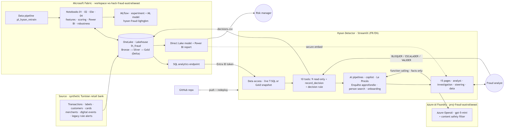

Editable Mermaid source: [diagrams/1_platform_and_ml.md](diagrams/1_platform_and_ml.md#end-to-end-architecture)

| Layer | Technology | Role |
|---|---|---|
| Data platform | Microsoft Fabric: OneLake, Lakehouse `lh_fraud`, Delta tables, Spark notebooks, data pipeline | Ingest, clean, compute features, score, store everything the app reads |
| Machine learning | LightGBM (champion) + HGB / LambdaRank / blend (challengers), TreeSHAP, MLflow | Fraud score, explanations, model registry |
| Deep learning | gpt-5-mini (transformer LLM) deployed in Azure AI Foundry | Understands the analyst's question, writes the explanation from tool facts |
| Application | Streamlit (Python), 10 tools, 8 AI pipelines | Analyst workflow: queue → transaction → explanation → decision |
| BI | Direct Lake semantic model + Power BI report (built as code) | Manager KPIs, embedded in the app |
| Delivery | GitHub, Streamlit Community Cloud | Versioning, hosted demo, auto-redeploy on push |

---

## 2. Microsoft Fabric data platform

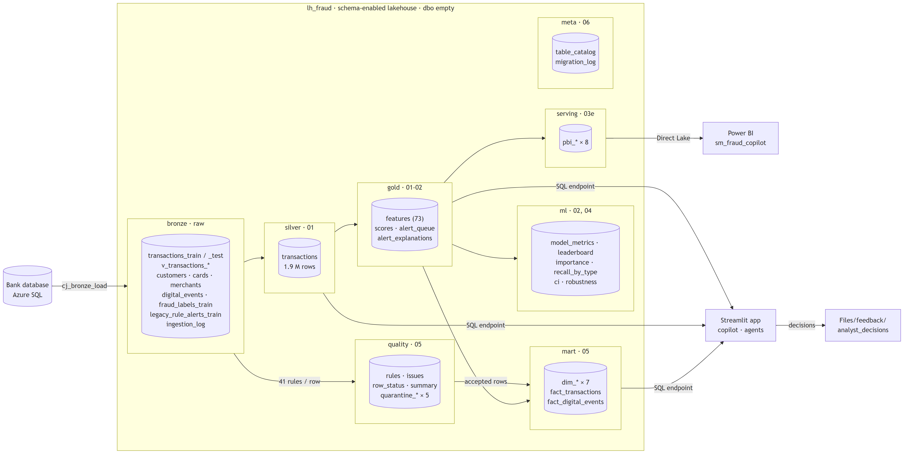

Editable Mermaid source: [diagrams/1_platform_and_ml.md](diagrams/1_platform_and_ml.md#microsoft-fabric-data-platform)

| Schema | Role | Tables | Content | Written by | Read by |
|---|---|---|---|---|---|
| `bronze` | Raw data as delivered by the bank | 11 | `transactions_train`, `transactions_test`, `customers`, `cards`, `merchants`, `digital_events`, `fraud_labels_train`, `legacy_rule_alerts_train`, `v_transactions_all`, `v_transactions_train_labeled`, `ingestion_log` | 05_quality_star, cj_bronze_load | 01, 05 |
| `quality` | Row-level data quality and quarantine | 9 | `rules`, `issues`, `row_status`, `summary`, `quarantine_transactions`, `quarantine_customers`, `quarantine_cards`, `quarantine_merchants`, `quarantine_digital_events` | 05_quality_star | app (Données), audit |
| `silver` | Cleaned, conformed and joined operations | 1 | `transactions` | 01_silver_features | 01, 03e, app (history, related cases, context) |
| `gold` | Features, scores, alert queue, explanations | 4 | `features`, `scores`, `alert_queue`, `alert_explanations` | 01_silver_features, 02_score_explain | 02, 04, app, copilot tools |
| `ml` | Model evaluation and robustness | 7 | `model_metrics`, `model_leaderboard`, `model_importance`, `model_recall_by_type`, `model_ci`, `model_robustness`, `model_robustness_types` | 02_score_explain, 04_robustness | app (Performance), 03e |
| `mart` | Star schema for analysis | 9 | `dim_date`, `dim_heure`, `dim_geo`, `dim_client`, `dim_merchant`, `dim_channel`, `dim_card`, `fact_transactions`, `fact_digital_events` | 05_quality_star | app (Assistant IA, Intelligence fraude) |
| `serving` | Tables served to the Power BI report | 8 | `pbi_alerts`, `pbi_compare`, `pbi_factors`, `pbi_importance`, `pbi_kpi`, `pbi_leaderboard`, `pbi_recall_type`, `pbi_recall_wide` | 03e_powerbi_dashboard | Direct Lake model sm_fraud_copilot |
| `meta` | Data catalog and migration log | 2 | `table_catalog`, `migration_log` | 06_lakehouse_layout | data architects, audit |

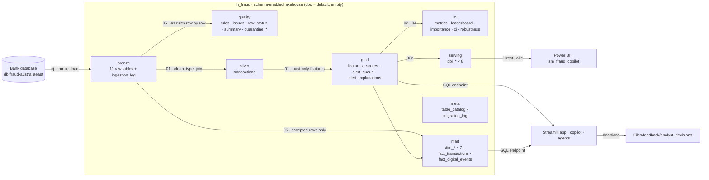

**Files/** · `landing/partner_feeds/` (new bank feeds before validation) · `exports/app_snapshot/` (Gold snapshot for the hosted app) · `exports/submission/` (score file, brief §14) · `feedback/analyst_decisions/decisions.csv` (analyst decisions, hash-chained) · `ml/robustness/` (backtest summary, runtime versions) · `README.md`.

Conventions: one schema per layer or purpose; bronze keeps the source names (traceable to the bank's database); redundant prefixes dropped elsewhere (`gold.scores`, not `gold.gold_scores`); `serving.pbi_*` is a contract with the Power BI model; the layout is code ([`app/layout.py`](../app/layout.py)) and is published in `meta.table_catalog` (role, producer, previous name, rows, columns). Migration: notebook `06_lakehouse_layout` (copy → verify counts and columns → repoint consumers → drop `dbo`), every step in `meta.migration_log`.

---

## 3. ML pipeline: features, training, scoring, explanations

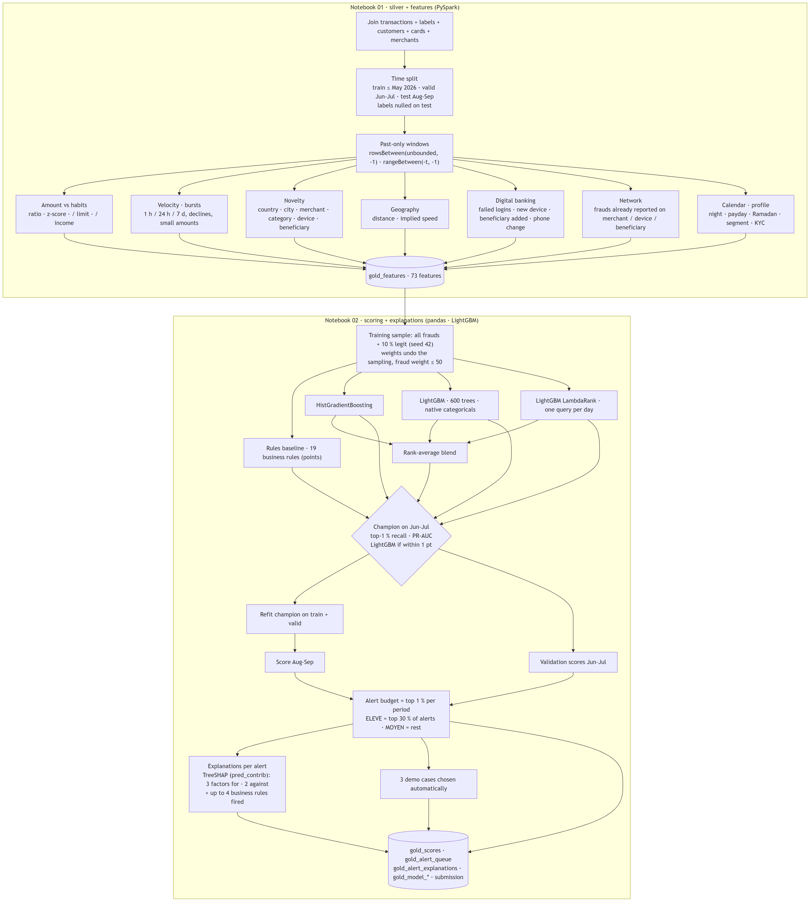

Editable Mermaid source: [diagrams/1_platform_and_ml.md](diagrams/1_platform_and_ml.md#ml-pipeline-features-training-scoring-explanations)

| Step | Method | Why |
|---|---|---|
| Split | By time, never random (train ≤ May 2026, valid Jun–Jul, test Aug–Sep) | A random split mixes the same fraud episode between train and validation |
| Features | Spark window functions over the **past only**; graph features count only frauds reported **before** the transaction | No future information (brief §7, §8.6) |
| Excluded | `gender`, IDs, `fraud_scenario`, `fraud_reported_date` (except "already reported"), target-encoded entity risk | Fairness and leakage (checked by an `assert`) |
| Imbalance | Down-sample legit to 10 %, sample weights restore the real ratio | 0.55 % fraud rate |
| Models | Rules · HGB · **LightGBM** · LambdaRank · blend | Gradient boosting is the reference for tabular data |
| Selection | Top-1 % recall then PR-AUC on Jun–Jul; LightGBM preferred within 1 pt | One model both scores and explains |
| Threshold | Top 1 % per period (analyst capacity) | Brief §8.4 |
| Explanations | TreeSHAP contributions from the same LightGBM + business rules | Facts the copilot reads instead of inventing |

---

## 4. Validation and MLOps lifecycle

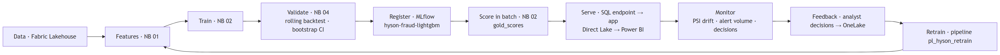

Editable Mermaid source: [diagrams/2_mlops_foundry_ml_dl.md](diagrams/2_mlops_foundry_ml_dl.md#mlops-lifecycle)

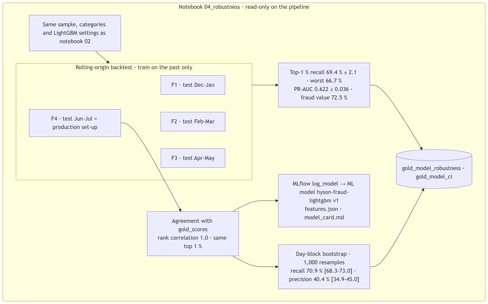

Editable Mermaid source: [diagrams/2_mlops_foundry_ml_dl.md](diagrams/2_mlops_foundry_ml_dl.md#notebook-04-robustness-and-model-registry)

| MLOps element | Where | Status |
|---|---|---|
| Experiment tracking | MLflow experiments `02_score_explain`, `hyson-fraud-robustness` (1 run per fold) | ✅ |
| Model registry | ML model `hyson-fraud-lightgbm` v1 = production scores | ✅ |
| Orchestration | Data pipeline `pl_hyson_retrain` (01 → 02 → 03e ∥ 04, retry 1) | ✅ created, not scheduled (re-scoring changes demo IDs) |
| Reproducibility | Seeds, same sampling, `fabric/environment.yml` (runtime versions) | ✅ |
| Monitoring | PSI drift of the score distribution (Impact page), alert volume per day, fairness by segment / age (Performance page), copilot log | ✅ |
| Testing | 93 pytest tests (`tests/`) on every push (GitHub Actions) + copilot golden evaluation (18 questions) | ✅ |
| Feedback loop | `decisions.csv` → OneLake `Files/feedback/analyst_decisions` → labels for the next run | ✅ |
| Next | Schedule the pipeline, champion/challenger in shadow mode, drift alert with Data Activator | Roadmap |

---

## 5. Azure AI Foundry and Azure OpenAI layer

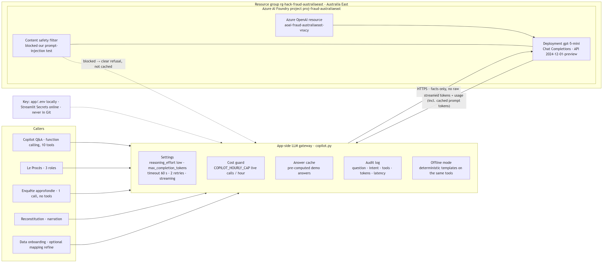

Editable Mermaid source: [diagrams/2_mlops_foundry_ml_dl.md](diagrams/2_mlops_foundry_ml_dl.md#azure-ai-foundry-and-azure-openai-layer)

| Setting | Value | Why |
|---|---|---|
| Model | `gpt-5-mini` (reasoning model) | Good French/English, function calling, low cost |
| Reasoning effort | `low` (copilot, Le Procès) · `minimal` (Enquête approfondie, one retry with `low` if the answer contradicts itself) | Latency and tokens |
| Prompt | Static system prompt first (≈ 1,400–2,000 tokens served by Azure prompt caching), then facts | ≈ 3,300 tokens and ≈ 7 s per new question, 1 LLM round |
| Safety | Azure content filter + app guardrails (off-topic refusal, unknown ID answered without LLM, no field names, decision fixed by rule) | Brief §9.8 |
| Cost control | Cache, prefetch (1 round), hourly cap on the public demo, every call logged with tokens | FinOps |

---

## 6. Where ML and DL are used

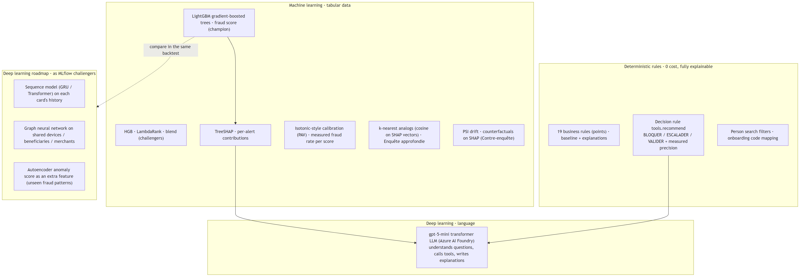

Editable Mermaid source: [diagrams/2_mlops_foundry_ml_dl.md](diagrams/2_mlops_foundry_ml_dl.md#where-ml-and-dl-are-used)

| Need | Technique | Type | Why this choice |
|---|---|---|---|
| Score each transaction | LightGBM | ML | Best on tabular data, fast, exact explanations (TreeSHAP), auditable by a risk team |
| Explain the score | TreeSHAP + business rules | ML + rules | Same model that scores, numbers the copilot can cite |
| Decide | Documented rule with measured precision | Rules | Reproducible; the LLM never decides |
| Talk with the analyst | gpt-5-mini | **DL** (transformer) | Natural language FR/EN, function calling, summarising |
| Similar past cases | Cosine k-NN on SHAP vectors | ML | 0 token, explains "alerts like this were X % fraud" |
| Why not DL for the score | — | — | Tabular data where boosting is the state of the art; DL adds cost and opacity. Kept as challengers (roadmap), validated with the same backtest and registered in MLflow before any switch |

---

## 7. AI pipelines, one by one

### 7.1 Copilot question → answer

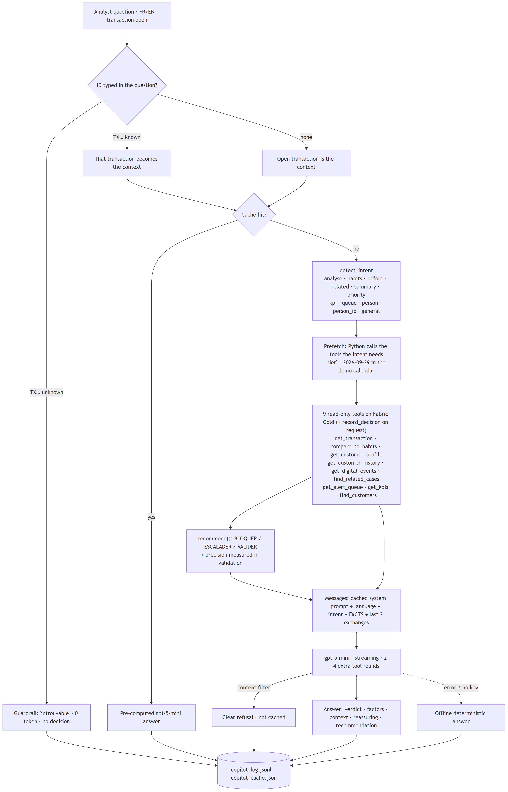

Editable Mermaid source: [diagrams/3_ai_pipelines_part1.md](diagrams/3_ai_pipelines_part1.md#ai-pipeline-1-copilot-question-to-answer)

### 7.2 Le Procès (three AI roles)

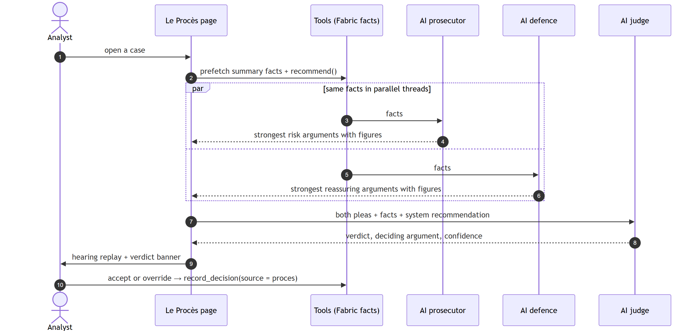

Editable Mermaid source: [diagrams/3_ai_pipelines_part1.md](diagrams/3_ai_pipelines_part1.md#ai-pipeline-2-le-proces)

### 7.3 Enquête approfondie (deep search on medium alerts)

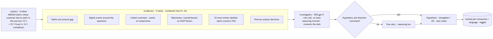

Editable Mermaid source: [diagrams/3_ai_pipelines_part1.md](diagrams/3_ai_pipelines_part1.md#ai-pipeline-3-enquete-approfondie)

### 7.4 Reconstitution (crime-scene replay)

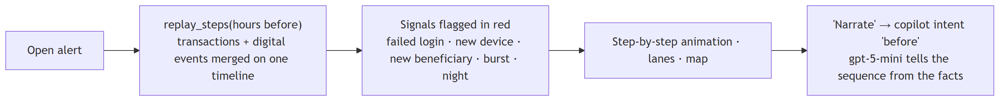

Editable Mermaid source: [diagrams/3_ai_pipelines_part1.md](diagrams/3_ai_pipelines_part1.md#ai-pipeline-4-reconstitution)

### 7.5 Person search ("le client retraité de Sfax de plus de 70 ans avec des alertes")

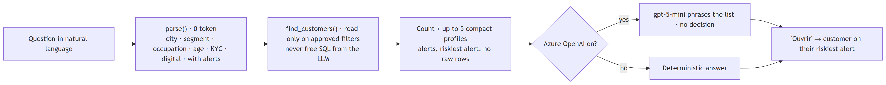

Editable Mermaid source: [diagrams/4_ai_pipelines_part2.md](diagrams/4_ai_pipelines_part2.md#ai-pipeline-5-person-search)

### 7.6 New data source onboarding (translate · measure · approve)

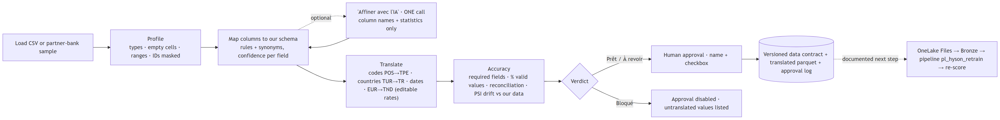

Editable Mermaid source: [diagrams/4_ai_pipelines_part2.md](diagrams/4_ai_pipelines_part2.md#ai-pipeline-6-new-data-source-onboarding)

### 7.7 Copilot evaluation (golden questions)

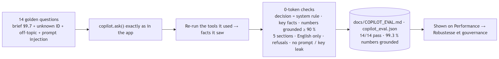

Editable Mermaid source: [diagrams/4_ai_pipelines_part2.md](diagrams/4_ai_pipelines_part2.md#ai-pipeline-7-copilot-evaluation)

### 7.8 Power BI as code (notebook 03e)

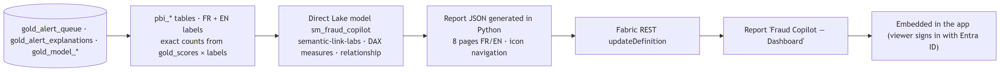

Editable Mermaid source: [diagrams/4_ai_pipelines_part2.md](diagrams/4_ai_pipelines_part2.md#ai-pipeline-8-power-bi-as-code)

---

## 8. Application pages and demo path

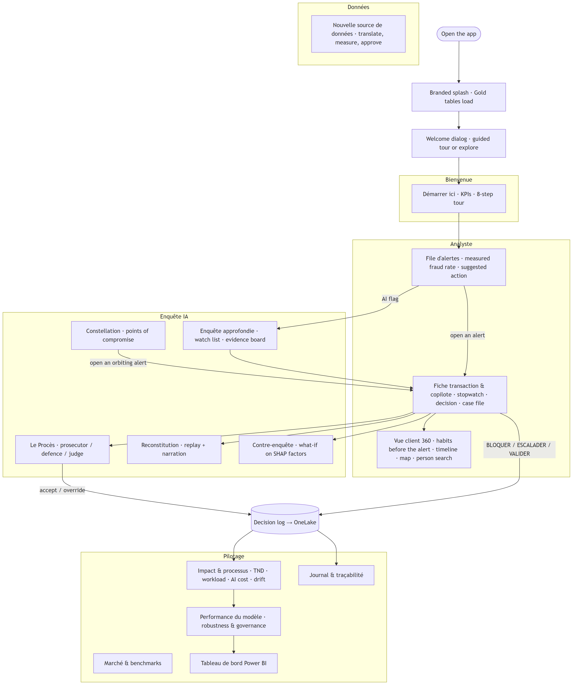

Editable Mermaid source: [diagrams/5_app_and_deployment.md](diagrams/5_app_and_deployment.md#application-pages)

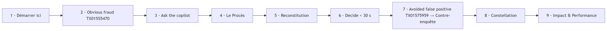

Editable Mermaid source: [diagrams/5_app_and_deployment.md](diagrams/5_app_and_deployment.md#demo-path)

---

## 9. Deployment, security and CI/CD

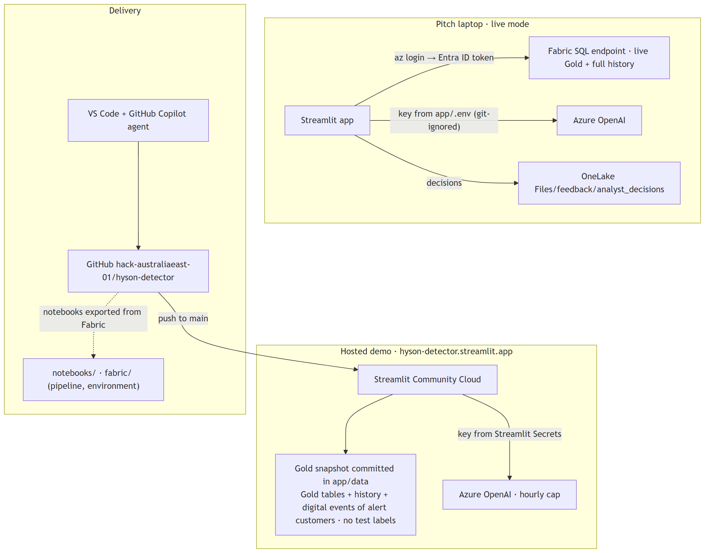

Editable Mermaid source: [diagrams/5_app_and_deployment.md](diagrams/5_app_and_deployment.md#deployment-security-and-cicd)

| Control | How |
|---|---|
| Identity | Fabric access with the analyst's Entra ID token (`az login`); no database password anywhere |
| Secrets | Azure OpenAI key only in `app/.env` (git-ignored) or Streamlit Secrets; scanned out of the repo and its history |
| Data minimisation | The LLM receives compact tool facts, never raw tables; person search uses approved filters; onboarding AI sees column names and statistics only |
| Labels | Test labels are NULL everywhere; graph features use frauds reported **before** the transaction |
| Traceability | Every LLM call logged (question, intent, tools, tokens, latency); every decision and data approval logged |
| Cost | Cache, 1-round prefetch, prompt caching, hourly cap on the public demo |
| Production next steps | Private endpoint + managed identity for Azure OpenAI, RBAC / row-level security, PII masking, real-time scoring with Eventstream + Eventhouse |

## 10. Continuous fraud intelligence (unified architecture)

How the advanced investigation layer extends the existing system without rebuilding it: the ML model still scores; around it, events
keep a case alive, a behavioural memory recalls precedents, three agents argue and judge on numbered evidence, the employee decides,
and the steering layer turns aggregates into hypotheses to investigate.

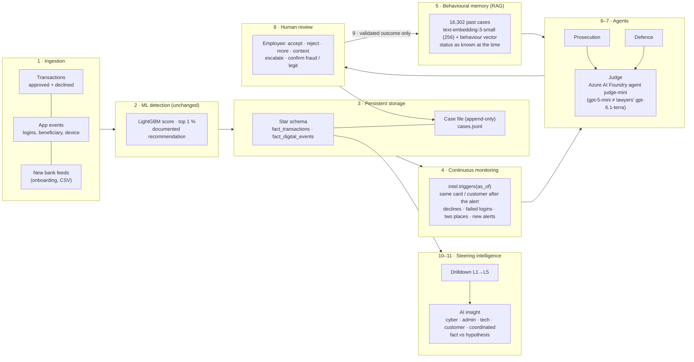

| Brief step | Where | Guardrail |
|---|---|---|
| Ingestion, event storage | star schema (notebook 05), `intel.stream()`, `context.batch()` for new feeds | quality rules row by row, quarantine |
| Continuous monitoring, reactivation | `intel.triggers(tid, as_of)` — documented rules, weights | `as_of` time travel: never the future |
| RAG retrieval | `memory.similar()` — hybrid cosine (meaning 0.5 + behaviour 0.5) over 16,302 cases | only earlier cases; fraud = confirmed only if reported before; AI conclusions never stored as knowledge |
| Multi-agent investigation | `investigation.py` — Prosecution / Defence (gpt-6.1-terra) on board E1…En | must cite E-numbers; code checks every citation |
| Judge | Azure AI Foundry agent `judge-mini` on **gpt-5-mini** (managed harness, Entra ID) while the lawyers argue on gpt-6.1-terra; fallback gpt-5-mini by key — the judge never shares the lawyers' model (Le Procès: the reverse, gpt-5-mini argues, `judge-patern` on gpt-6.1-terra judges) | grades evidence reliability; may deviate from the system only with post-alert evidence, shown side by side |
| Human review, knowledge update | case page actions → `cases.jsonl` + decision journal | rationale required; "confirmed" only by the employee after contact or the bank's report |
| Steering KPIs, drilldown | `steering.py` — fixed read-only SQL, click a bar to go down | aggregates; transactions without customer identity |
| AI strategic analysis | facts K1…Kn in SQL → AI classifies, cites, separates fact / hypothesis | no data on employees / switch logs → stated as missing, confidence low |

**Measured honestly:** the memory alone barely predicts fraud on validation alerts (ROC-AUC 0.57 vs 0.85 for the model; blending
them does not help: 0.84) — so it is used as precedent and context for agents and employees, never added to the score.

## 11. Universal banking integration (any bank, any schema)

The Hyson pages run on the Hyson tenant (Fabric lakehouse `lh_fraud`). To serve **other banks without rewriting anything**, a
bank-agnostic layer maps each bank's own schema to a canonical model, measures what the data can support, and activates only the
modules it can feed — after a named human approval. Same engine behind the console page *Intégration bancaire* and the REST API.

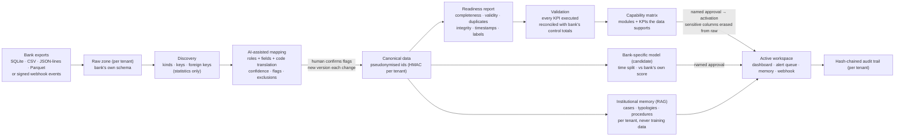

| Brief component | Where | Guardrail |
|---|---|---|
| Canonical model + capability catalogue | `app/canonical.py` (7 entities, 15 modules, 13 KPIs with their SQL) | a module is active only if every field it needs is mapped and ≥ 90 % translatable |
| Multi-source connection | `discovery.load()` — SQLite, CSV (separator sniffed), JSON-lines / JSON, Parquet, uploads; `tenants.ingest()` keeps a parquet copy per batch | size limits, read-only SQLite |
| Schema discovery | `discovery.summary()` — value kinds (epoch ms/s, dd/mm/yyyy, decimal comma, ISO-2/3, currency, e-mail, PAN-like), candidate keys, foreign keys by value inclusion (≥ 90 %) | only statistics leave the module |
| AI-assisted mapping | `mapper.propose()` — table roles + fields: name similarity (FR / EN / camelCase synonyms) 60 % + value fit 40 %; code dictionaries (GAB, E-COMMERCE, ACCEPTEE, ISO 8583 `00`/`05`, EMV/NFC, LOGIN/ADD_PAYEE…); optional one-call LLM review on names + stats (`mapper.ai_review`) | uncertain items become **flags to confirm** (minor units, 0/1 status, labels by presence, assumed currency, < 80 % confidence) |
| Sensitive data | `canonical.EXCLUDED` (gender, CVV, PIN, names, e-mail, phone, address, IBAN, national id) never mapped; ids pseudonymised by HMAC-SHA256 with a per-tenant salt; raw PAN detected (Luhn) and hashed | excluded columns erased from the raw zone at activation (minimisation) |
| Translation | `mapper.apply()` — dates, epoch, decimal comma, minor units, FX to TND (editable rates), ISO-3 → ISO-2, labels from a separate report table, merchant attributes joined | untranslated values counted per field |
| Data readiness | `readiness.report()` — score /100 + gate (green / amber / red), blockers, warnings, label adequacy (≥ 30 frauds over ≥ 3 months) | red gate blocks validation |
| Dynamic configuration | `tenants.validate()` — runs every enabled KPI on the canonical data (DuckDB, no external access), keeps those that run; dashboard = active KPIs + modules | KPI SQL is a fixed catalogue, never generated |
| Reconciliation | `tenants.validate(control)` — counts, frauds, amounts vs the bank's own control totals | validation fails if a total differs |
| Approval and activation | `approve(name)` then `activate(name)`; lifecycle draft → mapped → validated → approved → active | any mapping change sends the tenant back to *mapped*; open flags block approval |
| Bank-specific model | `tenant_model.py` — L2 logistic regression (numpy, JSON, no pickle) on past-only generic signals (amount vs own habits, burst, new country / merchant / device, night, failed logins and sensitive account changes before the operation); train on the first 70 % of time, test on the rest; compared with the bank's own score | stays a *candidate* until a named admin approves it; never retrained automatically |
| No labels | `tenant_model.behaviour_score()` — departures from the customer's own habits | shown as "not a fraud probability"; fraud KPIs and supervised modules disabled with the reason |
| Institutional RAG | `tenant_rag.py` — TF-IDF (offline) over the bank's case notes, typology statistics and uploaded procedures; grounded answer with citations if Azure OpenAI is configured | one index per tenant; never used to train |
| Real time | `POST /v1/tenants/{id}/events` — records in the bank's own format, translated by the **active** mapping, appended, scored with reasons | HMAC-SHA256 over `timestamp.body`, 5-minute replay window, idempotent on transaction id, 1,000 records max |
| Multi-tenant security | `tenants.py` + `api.py` — one folder per bank, API keys `hy_<tenant>_…` stored as SHA-256 with roles admin / analyst / ingest, platform key to create banks, per-key rate limit, payload limits | a key never reaches another tenant (403) |
| Audit | `tenants.audit()` — every step (ingest, mapping versions, validation, approvals, model, events) in a SHA-256 hash chain, verified on screen and by `GET /audit` | tampering detected (test) |

**Validated on three simulated banks** with deliberately different schemas, derived from the synthetic dataset
(`app/build_bank_fixtures.py`, totals in `app/samples/banks/truth.json`), end to end and offline (`tests/test_integration.py`):

| Bank | Source | Recognised automatically | Reconciliation | Modules | Model on later months |
|---|---|---|---|---|---|
| Banque Atlas | SQLite, French names, dd/mm/yyyy, fraud reports in a separate table, `nom_complet` + `cvv` | 4/4 table roles; labels by presence (confirmed) | 13,207 ops · 111 frauds · 2,467,541.162 TND exact | 13/15 (no auth logs → no replay / auth anomalies) | PR-AUC 0.18 (base 1.3 %), top 1 % precision 22 % |
| Nordic Pay | 6 CSV, camelCase, epoch ms, EUR cents, ISO 8583, auth logs, cases, `email` + `gender` | 6/6 roles; cents and response codes flagged | 15,408 · 127 · 796,546.06 EUR exact | 15/15 | PR-AUC 0.155 vs **0.025** for the bank's own rules score; top 1 % 28 % vs 9 % |
| Sahel Bank | one JSON-lines extract, ISO-3, "1 234,500", numeric status, no labels | 1/1; 0/1 status flagged | 8,853 · 1,749,037.101 TND exact | 5/15 (no labels → no fraud KPIs, no model) | behaviour score only (honestly labelled) |

**Limits, stated:** the 15 Hyson pages themselves still read the Hyson tenant; a new bank gets the generated workspace (dashboard,
queue, memory, real time) and the capability-gated module list — wiring each Hyson page to tenant data is the next step. Tenant
storage is local files (production: one OneLake workspace / lakehouse per bank, secrets in Key Vault, keys in Entra ID). The
unsupervised behaviour score is weak alone (ROC-AUC 0.67–0.70 when checked on Atlas / Nordic labels): it orders the review, it
does not decide.

## 12. AI reporting engine (professional, evidence-based reports)

A bank employee asks for a report in plain language (French, English or Arabic); the platform understands the need, analyses
the data **before** writing, verifies every figure, adapts the document to its reader and waits for a named approval.
Same engine for the Hyson bank and for every onboarded bank (tenant), on one canonical SQL surface.

```mermaid
flowchart LR
    REQ["Request in plain language<br/>FR · EN · AR"] --> INT["Request interpreter<br/>type · audience · period (+ previous)<br/>scope · focus · depth · format · confidentiality"]
    INT -->|"essential info missing → one question"| REQ
    INT --> RET["Data retrieval<br/>canonical views tx / auth<br/>Hyson star schema or tenant data"]
    RET --> ANA["Analytical queries (SQL)<br/>facts F# · tables T#<br/>confirmed ≠ suspected"]
    ANA --> VER["Verification<br/>period · duplicates · sums · recount<br/>label coverage · evidence links"]
    VER --> INS["Interpretation (rules)<br/>insights I#: what · evidence · why<br/>hypotheses · impact · action · priority"]
    INS --> GEN["Composition by audience<br/>+ charts C# (title, unit, period, source)"]
    GEN --> AIW["Optional AI writer<br/>kept only if every number is in the evidence"]
    AIW --> REV["Review: preview · edit · regenerate section<br/>change audience / period · comments · compare versions"]
    REV --> APP["Named approval → PDF · DOCX · HTML · XLSX<br/>archived with SHA-256 · hash-chained audit"]
```

| Brief component | Where | Guardrail |
|---|---|---|
| Request interpreter, audience & requirements analyzer | `report_interpret.py` — rules (0 token) for type, audience, explicit or relative periods (Q2 2026, août 2026, الربع الثاني, du … au …, last quarter), comparison, scope (channels, card types, cities, countries), focus, depth, format, confidentiality, language; optional single LLM refinement on the request text only | defaults are listed as assumptions; a question only when essential (investigation without a transaction, no data in the period); fraud reports default to the last period with confirmed labels |
| Data retrieval | `report_sources.py` — views `tx` / `auth` over the Hyson star schema (`mart`, exported from Fabric) or a tenant's canonical data | read-only DuckDB, file access locked, one cursor per query, 100 MB memory limit |
| Analytical query + statistical validation | `report_analysis.py` — fixed SQL per figure (overview, previous period, breakdowns with share / rate / over-representation, trend, authentication, 3-D Secure / stripe, decline reasons, decisions) | confirmed fraud = bank label; suspected = model alert without label; model / rules coverage measured only where they exist; independent recount, breakdown sums, duplicates, label coverage |
| RAG / investigation evidence | `investigation_case()` reuses the evidence board, system recommendation, 16,302-case memory, monitoring triggers, the employee decision and (optional) the three agents; tenants use their own memory | AI arguments shown as AI, never as a decision; customer identity not reproduced |
| Interpretation | `report_insights.py` — documented thresholds (≥ 5 frauds, ≥ 30 operations, ×1.5 share); change vs previous period; emerging segments; night, 3-D Secure, stripe; model vs rules; exposure; account-takeover and login-spike **indicators** | each insight = what / evidence ids / why / hypotheses / impact / action / priority; security items never claim an attack |
| Report generation agent | `report_compose.py` — sections by type and audience (executive, analyst, cyber, operations), depth, institution terminology and departments | the same facts for every audience (tested) |
| Visualisations | matplotlib: trend, share of frauds vs share of transactions, period comparison, failed logins | title, unit, period, source and a one-line reading on every chart |
| Evidence traceability | evidence register (F#, T#, I#) with value, kind, method, SQL, period, source, timestamp; every statement tagged *verified fact / ML prediction / AI interpretation / employee-confirmed / hypothesis / recommendation / data limitation* | AI paragraphs rejected if any number is not in the evidence (`grounded()`) |
| Formatting & export | `report_render.py` — HTML, PDF (reportlab, DejaVu fonts, Arabic shaping + right-to-left wrapping), DOCX (python-docx, `w:bidi`), XLSX (evidence + tables + findings + checks) | drafts watermarked; approved files carry approver, version and hash |
| Review & approval, document management | `report_store.py` — versions, edit section (employee statement), regenerate a section or the report (audience, period, depth), comments, version diff, named approval (blocked if an error-level check fails), archived files with SHA-256, saved templates, institution branding, hash-chained audit (a tenant's report steps join the tenant's own chain) | stored per bank: Hyson in `app/data/reports`, each bank in its tenant folder |
| UI and API | page **Rapports IA** (`reportpage.py`); `POST/GET /v1/tenants/{id}/reports`, `…/approve` (admin), `…/export?format=` | analyst creates, admin approves; another bank's key gets 403 |

**Measured:** the brief's example request ("detailed quarterly report … DAB … previous quarter … card categories … emerging
patterns … cyber or operational weaknesses … recommendations for management") is understood as a periodic report for management,
Q2 2026 vs Q1 2026, channel ATM, detailed, with cyber and processing sections; it is generated in ~4 s with 39 figures, 8 insights, 9 tables,
5 charts and 6/6 checks. Figures reconcile with the documented KPIs (Jun–Jul 2026: 1,779 model alerts, 718 confirmed frauds caught).
On Aug–Sep 2026 (no labels yet) the report contains **no** confirmed-fraud figure, only suspected alerts, and says why.
