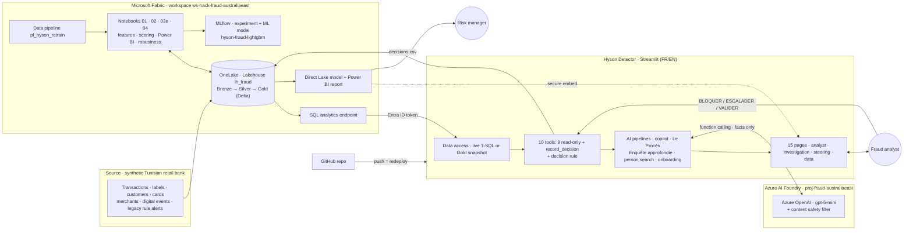
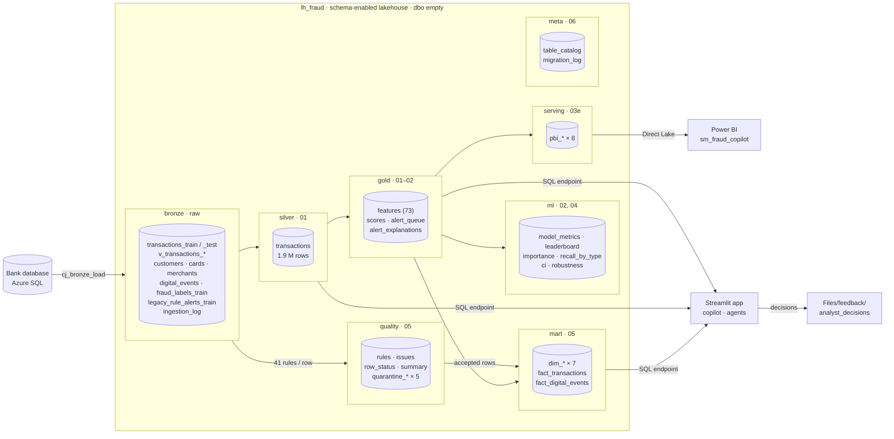
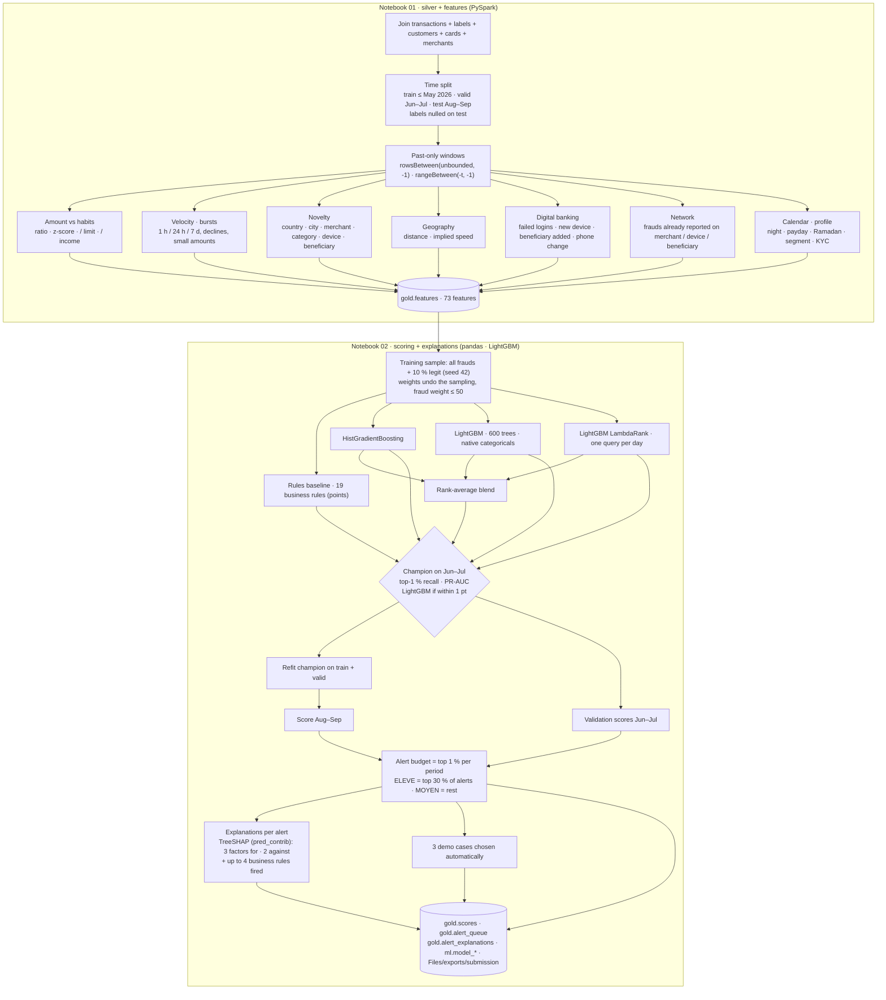

# Hyson Detector diagrams · Platform and ML (diagrams 1–3)

Mermaid source of the diagrams shown as images in [../ARCHITECTURE.md](../ARCHITECTURE.md). GitHub renders them below; to regenerate the PNGs run `python docs/diagrams/render.py`.

## End-to-end architecture
<!-- img: 01_end_to_end -->

## Microsoft Fabric data platform
<!-- img: 02_fabric_platform -->

## ML pipeline: features, training, scoring, explanations
<!-- img: 03_ml_pipeline -->

