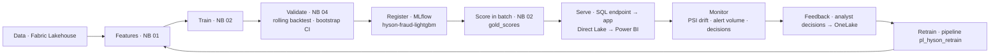
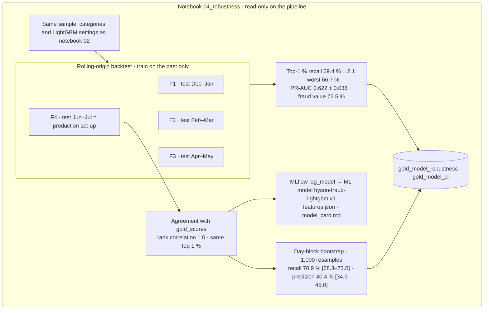
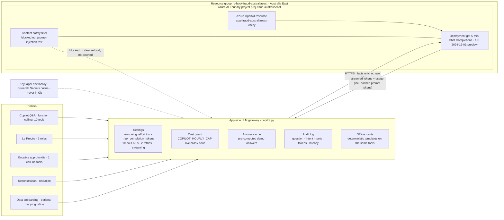
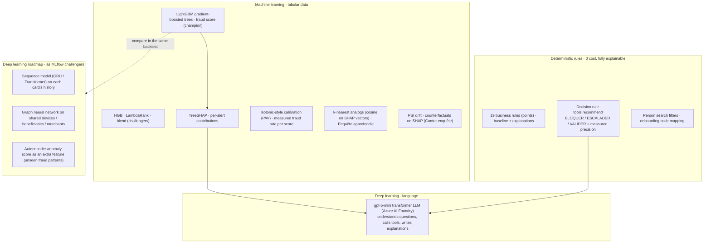

# Hyson Detector diagrams · MLOps, Azure AI Foundry, ML vs DL (diagrams 4–6)

Mermaid source of the diagrams shown as images in [../ARCHITECTURE.md](../ARCHITECTURE.md). GitHub renders them below; to regenerate the PNGs run `python docs/diagrams/render.py`.

## MLOps lifecycle
<!-- img: 04a_mlops_lifecycle -->

## Notebook 04: robustness and model registry
<!-- img: 04b_robustness_nb04 -->

## Azure AI Foundry and Azure OpenAI layer
<!-- img: 05_foundry_openai -->

## Where ML and DL are used
<!-- img: 06_ml_vs_dl -->

