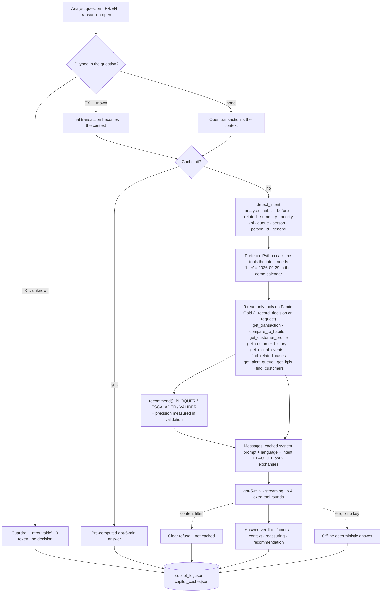
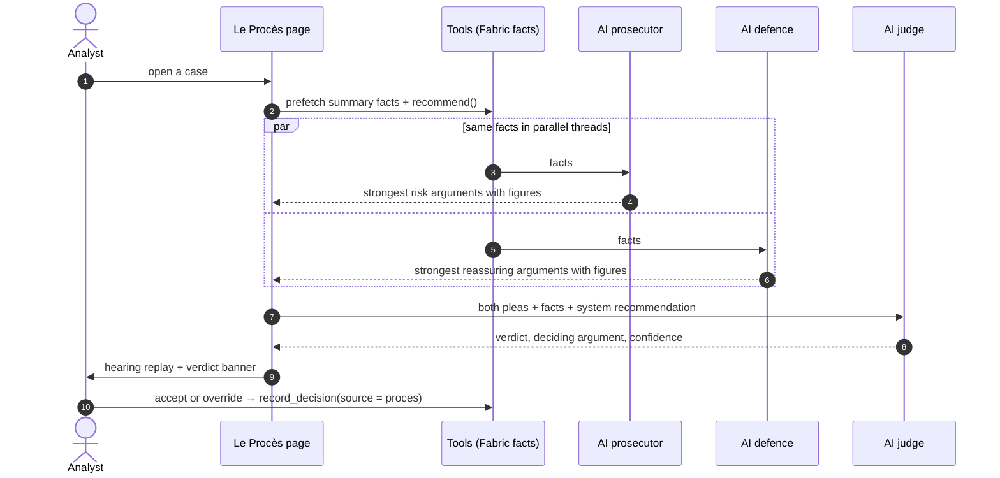
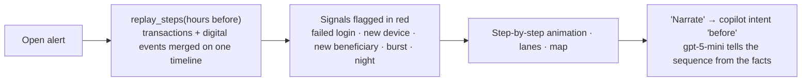

# Hyson Detector diagrams · AI pipelines 1–4 (copilot, Le Procès, Enquête approfondie, Reconstitution)

Mermaid source of the diagrams shown as images in [../ARCHITECTURE.md](../ARCHITECTURE.md). GitHub renders them below; to regenerate the PNGs run `python docs/diagrams/render.py`.

## AI pipeline 1: copilot question to answer
<!-- img: 07a_copilot_pipeline -->

## AI pipeline 2: Le Procès
<!-- img: 07b_le_proces -->

## AI pipeline 3: Enquête approfondie

```mermaid
flowchart LR
    W["watch() · 0 token<br/>MEDIUM alerts whose customer had an alert in the previous 72 h<br/>≈ 53 % fraud vs 16 % (validation)"] --> E
    subgraph E["evidence() · 0 token · numbered lines E1…En"]
        E1["Habits and amount gap"]
        E2["Digital events around the operation"]
        E3["Linked customers · points of compromise"]
        E4["Robustness: counterfactual on SHAP factors"]
        E5["25 most similar labelled alerts (cosine k-NN)"]
        E6["Previous analyst decisions"]
    end
    E --> LLM["investigate() · ONE gpt-5-mini call, no tools<br/>reasoning minimal · connects the dots"]
    LLM --> CHK{"Hypothesis and direction consistent?"}
    CHK -- no --> RT["One retry · reasoning low"]
    CHK -- yes --> OUT["Hypothesis · strengthen / lift · next check"]
    RT --> OUT
    OUT --> CL[("Cached per transaction + language · logged")]
```

<!-- img: 07c_enquete_approfondie -->

## AI pipeline 4: Reconstitution
<!-- img: 07d_reconstitution -->

