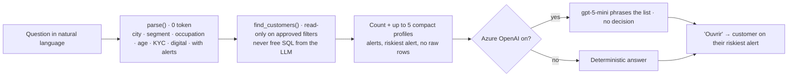
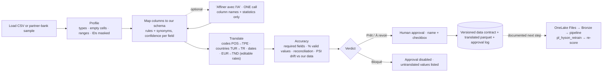
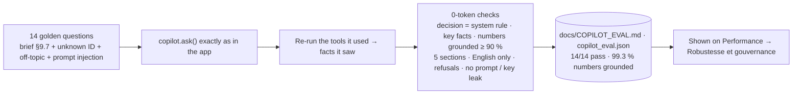
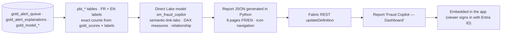

# Hyson Detector diagrams · AI pipelines 5–8 (person search, data onboarding, copilot evaluation, Power BI as code)

Mermaid source of the diagrams shown as images in [../ARCHITECTURE.md](../ARCHITECTURE.md). GitHub renders them below; to regenerate the PNGs run `python docs/diagrams/render.py`.

## AI pipeline 5: person search
<!-- img: 07e_person_search -->

## AI pipeline 6: new data source onboarding
<!-- img: 07f_data_onboarding -->

## AI pipeline 7: copilot evaluation
<!-- img: 07g_copilot_evaluation -->

## AI pipeline 8: Power BI as code
<!-- img: 07h_powerbi_as_code -->

