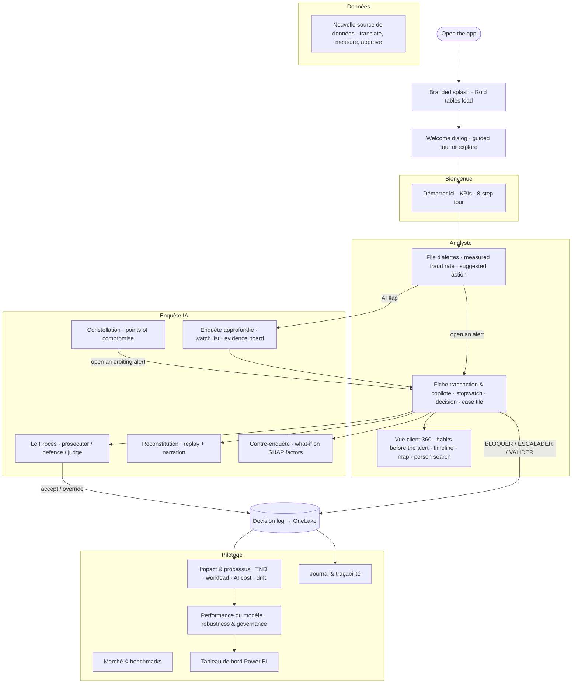
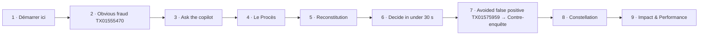
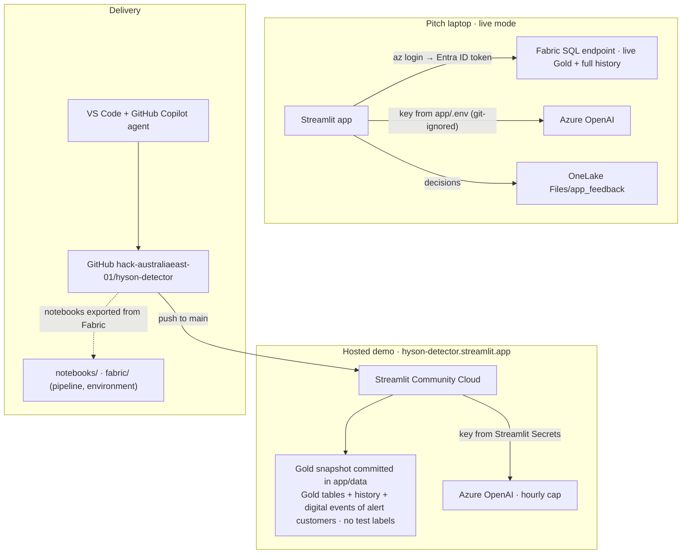

# Hyson Detector diagrams · Application, demo path, deployment (diagrams 8–9)

Mermaid source of the diagrams shown as images in [../ARCHITECTURE.md](../ARCHITECTURE.md). GitHub renders them below; to regenerate the PNGs run `python docs/diagrams/render.py`.

## Application pages
<!-- img: 08a_app_pages -->

## Demo path
<!-- img: 08b_demo_path -->

## Deployment, security and CI/CD
<!-- img: 09_deployment_security -->

